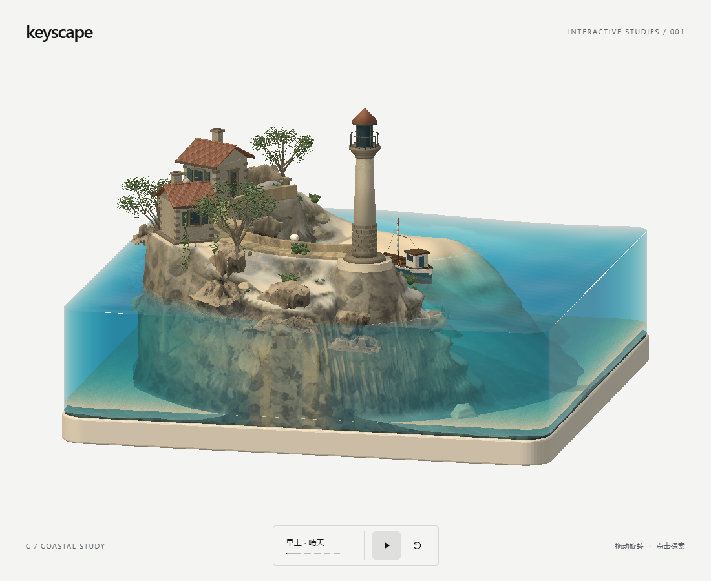

# Keyscape

**把一颗键，变成一个值得停留的世界。**

[在线体验](https://yang2-hue.github.io/Keyscape/) · [下一阶段方案：Space 月背温室](docs/concepts/next-keys/README.md)

An interactive keycap diorama built with React Three Fiber. 展厅里现在有两颗键：**C / 海岸**（月牙海湾、灯塔与渔船）和 **SPACE / 月背温室**（月面基地、气闸与玻璃温室）。左下角标签就是切换器，两件作品各有自己的时刻循环。



## 体验

**C / 海岸**

- 拖动旋转，滚轮或双指缩放；底部按钮暂停动态、恢复视角。
- 晴天、雨天、晴夜、雾夜、雨夜自动轮换，每段 20 秒。
- 点击水面激起波纹并惊动鱼群；点击渔船漂流，再次点击返航。
- 点击灯塔触发闪光与扫光；夜间灯塔与房屋窗户亮起。
- 点击小屋单独切换窗灯；轻点码头或海鸥，让海鸥振翅绕湾后归巢。交互留在场景中，供观看者自行发现。
**SPACE / 月背温室**

- 晨昏、正午、微尘、月夜四个时刻自动轮换；月球没有雨，天气是光照与月尘。
- 点击气闸开关舱门；点击温室开关室内灯与种植灯带；点击太阳能板让板面转向太阳。
- 夜间室内灯与窗片是唯一光源，星场随相机视差移动。
- 细节与已知不足见 [SPACE / 月背温室](docs/space-key.md)。

- 尊重系统「减少动态」偏好，暂停后采用按需渲染。

展厅目前是两件作品的原型，还没有整套键盘视图。

## 本地运行

需要 **Node.js 24 LTS** 和 **pnpm 11.25.0**。

```sh
pnpm install --frozen-lockfile
pnpm dev       # http://127.0.0.1:5173/
pnpm test
pnpm build
pnpm preview   # http://127.0.0.1:4173/
```

七件 GLB 和贴图随项目提供，运行不需要素材平台账号或 API 密钥。

模型编辑和 Blender 脚本的输入条件见 [资产制作说明](docs/assets.md)。

## 技术与结构

React 19、TypeScript、Vite、Three.js、React Three Fiber、Drei 与后处理。程序地形与 Blender 资产组成场景；GPU 波场驱动水面，独立状态驱动船鱼、天气及灯塔。

| 位置 | 用途 |
| --- | --- |
| `src/App.tsx`、`src/style.css` | 展厅、相机、自动时刻切换 |
| `src/CrescentStudy.tsx`、`src/crescent-bay.ts` | 资产装配、地形与交互 |
| `src/HarborWater.tsx`、`src/water-dynamics.ts` | 实时水面与波场 |
| `src/beacon-light.ts`、`src/weather*` | 灯塔和天气 |
| `public/models/` | 七件 GLB 及来源说明 |
| `scripts/blender/` | 建模与资产处理脚本 |
| `tests/` | 动线、几何、资产边界及状态测试 |

## 免费部署

项目没有后端，适合 GitHub Pages 或 Cloudflare Pages，见 [部署说明](docs/deployment.md)。工作流会在推送 `main` 后测试、构建和发布；首次使用需启用仓库的 Pages，来源选 GitHub Actions。

GitHub Pages 构建路径为 `/Keyscape/`；根域名部署保留 `VITE_BASE_PATH=/`。模型和首页链接均跟随构建路径。

## 验证与限制

当前测试集有 32 项单元测试。本轮 Blender 美术和新交互见 [海岸迭代记录](docs/coastal-refinement-v29.md)。浏览器专项曾验证加载、船鱼运动、暂停、地形封闭和光束残影修复；最终版本尚未重跑完整浏览器回归或验收真实设备性能。软件渲染截图不能证明真机流畅度，构建仍有较大 3D 依赖体积提示。

浏览器工具为可选依赖：安装 Playwright（`pnpm add -D playwright`）并运行 `pnpm exec playwright install chromium`。先启动开发服务，再运行 `pnpm verify`、`pnpm verify:motion`。可用 `PLAYWRIGHT_MODULE` 指向已有安装，`CHROME_PATH` 指定 Chrome。验收录屏脚本另需 FFmpeg。结果输出到未提交的 `outputs/`。

## 许可与贡献

原创代码和自行制作的模型采用 [MIT](LICENSE)。Poly Haven Coast Rocks 05 衍生资产保持 **CC0**，见 [素材来源](public/models/ASSET-SOURCES.md) 与 [第三方声明](NOTICE.md)。依赖遵循各自许可证。

参考作品：[resin-diorama-collection](https://github.com/luoban25/resin-diorama-collection)。未将该仓库源码或素材作为项目资产分发；致谢不代表拥有其许可。

贡献前请读 [贡献说明](CONTRIBUTING.md) 和 [工作约定](agent.md)。新键先通过视觉方案，再进入建模。
