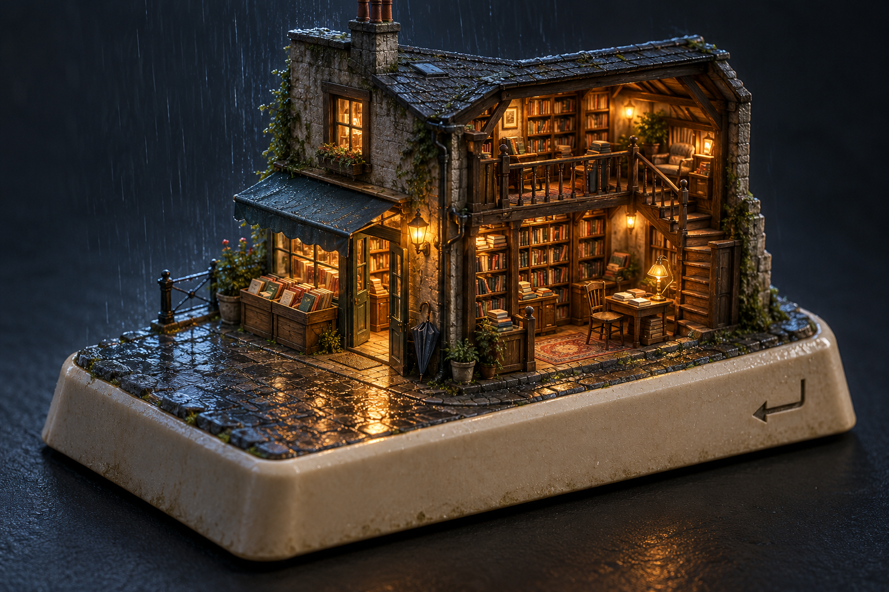
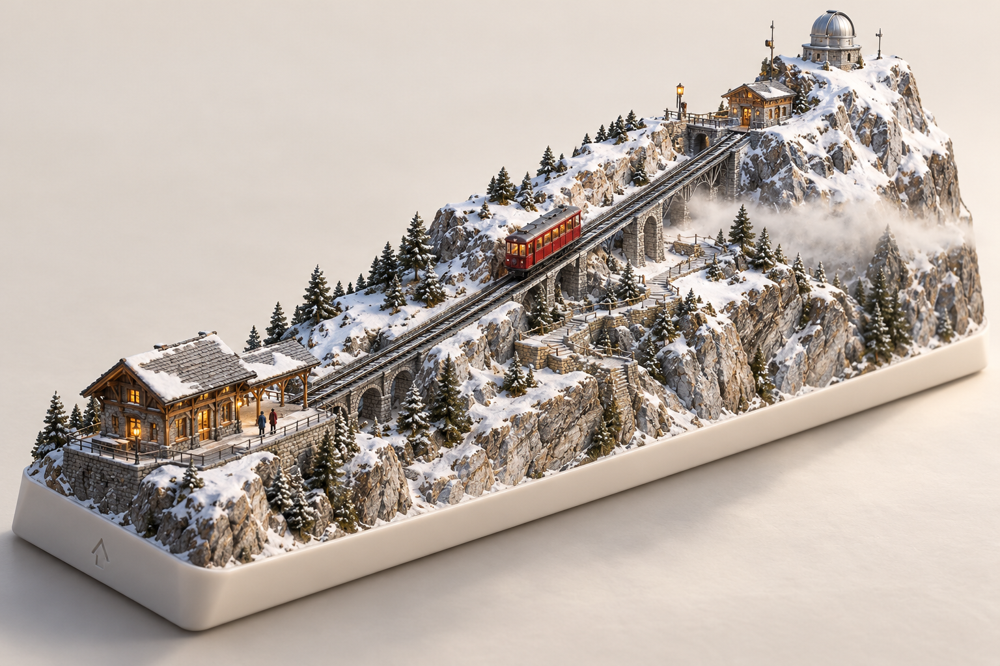

# 下一批单键概念 · 2026-10-26

以下三张由内置 imagegen 生成，是新一轮美术探索，**不是现有产品截图，也不是已完成的 3D 资产**。完整提示词见 [prompts.md](prompts.md)。当前公开产品仍只有 C / Coastal Study。

| 候选键 | 核心概念 | 键的特点如何参与表达 | 建议 |
| --- | --- | --- | --- |
| Enter | 雨夜书店 | 从键缘沿街道跨过门槛，进入有层次的内部世界 | 优先深化 |
| Space | 月背温室 | Space 的空间含义与长条键形，容纳从荒凉月面到温室的连续叙事 | 第二候选 |
| Shift | 雪线换乘 | 下站→上站的坡道与列车，把“上移”变成可见运动 | 暂作探索 |

## Enter · 雨夜书店

门口暖光是主焦点，湿街提供引导，建筑剖面呈现书架、桌椅与二层阅读区。选择理由：含义直接，模块化建筑资产可控，可以在现有雨、暂停和灯光系统上复用经验，避免再从大规模自然地形起步。

后续交互设想：点击或 Enter 键聚焦入口，门打开、相机缓慢靠近，窗灯逐层点亮；暂停时冻结雨、门与相机动画。先完成一个主视角，不先扩展整套键盘。

## Space · 月背温室

让荒凉与生命沿长条轮廓展开，温室内的植物与暖灯构成焦点。后续可让气闸启闭、太阳能板缓转、地球缓慢移动。月面外部没有地球天气；不要在真空月面添加雨、飘雾或无解释的风吹植被。

玻璃反射、透明排序与温室室内层次是主要风险。概念图没有证明温室的真实辐射防护、气密与热控，不能据此声称是科学工程设计。

## Shift · 雪线换乘

红色缆车与对角上行轨道给出明确视觉动线，高低站、步道和观测台相互连接。可探索点击后缆车上行、穿越薄雾层的短叙事。

当前生成稿的键底座明显过长，**不能直接作为真实 Shift 键的尺寸蓝图**。若入选，需要重画到 2.25u / 2.75u 比例，压缩横向跨度并重排山体、轨道与步道。建筑和轨道节点也必须在多视角下校验，不能把单图透视当作可施工几何。

## 下一步实施边界

推荐先选择 Enter，只做视觉确认与资产规格。三张都只是主视图，尚缺背面、侧面、剖面与尺寸，不能马上把整张图投入图生 3D 并当作成品。

1. 确定键型、轮廓、世界尺度、主视角与焦点，再补同一设计的侧／背视图。
2. 分开建筑外壳、可见室内、静态道具、门和灯；书籍和饰物用实例或合批，避免把每本书拆成独立运行对象。
3. 独立制作低模／中模，烘焙材质细节；门轴、灯光节点、碰撞和可达路径实际检查。
4. 灰模验证轮廓、门口与楼梯逻辑后再做最终材质。先保证静态主视角，再加入少量有意义动态。
5. 原型验收日夜、暂停、减少动态、触摸旋转与真实设备表现；视觉参考不能替代可运行验收。

以上是候选方向，不代表已获审美确认。未调用 Aholo、未批量生成 3D 模型，也未把这些场景加入现有线上产品。
