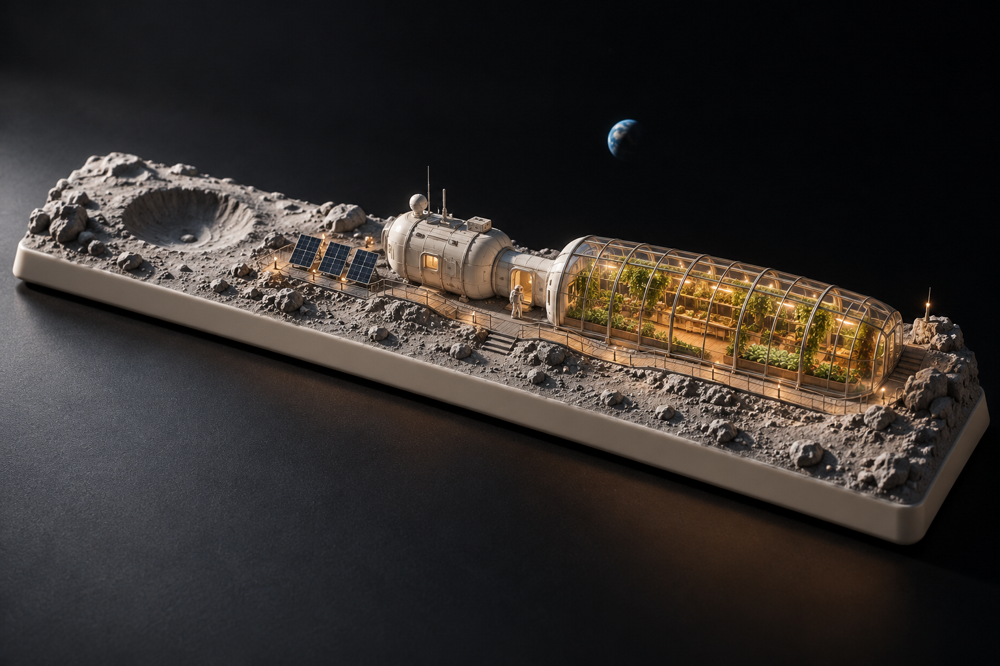

# 下一阶段方案：Space · 月背温室

2026-10-26 用户确认：**仅采纳 Space「月背温室」，其余本轮方向均不采纳。** 下一阶段只围绕这一方案深化，不继续推荐或实施其他候选。

下图由内置 imagegen 生成，是已采纳方向的主视觉参考，**不是现有产品截图，也不是已完成的 3D 资产**。原始提示词见 [prompts.md 的 space 段](prompts.md#space)。当前公开产品仍只有 C / Coastal Study。

## 主视觉与设计原则

Space 同时对应「空间」与长条空格键。以约 6.25u 的轮廓展开月面、居住舱、气闸与温室，让荒凉和生命形成对照。世界与内部生活是主角，键帽仅保留薄边和低调标识。

- **焦点：** 温室内部的植物、步道与暖灯；不要让键帽外壳、巨型星球或杂乱设备抢走主体。
- **构图：** 保留月坑的疏朗区域，与较密集的生活舱、温室取得平衡。外部通道连续到达气闸，室内通道连接植物区与生活区。
- **材质：** 冷灰月壤、哑光浅色舱体、细金属框架、清晰而克制的玻璃反射，搭配植物绿色和室内暖光。
- **氛围：** 安静、有生命感，外部冷静、内部温暖；不添加霓虹灯带或大量装饰粒子。

## 动态与交互设想

优先实现气闸门启闭、室内分区灯光和相机聚焦温室。太阳能板缓转、温室内部通风引起的细微叶片运动可作为后续增强，不先堆叠动效。

按键或点击触发须能与页面焦点、默认空格滚动协调；门、植物及镜头动画服从暂停和减少动态偏好。具体分镜与节奏在实现前另行确认。

月面外部不添加雨、飘雾或无解释的风吹植被。原稿天空中的地球与「月背」设定不一致：后续多视图应移除该地球，采用星空背景；保留已采纳的主体构图和温室氛围。

## 交接与实施步骤

当前确认的是视觉方向，尚缺背面、侧面、剖面与尺寸。不能把整张主视图直接投入图生 3D 并当作成品。

1. 补齐同一温室设计的侧／背视图和室内剖面，锁定空格键轮廓、相机、比例及通道位置。
2. 拆分月面底盘、生活舱、气闸、温室框架、玻璃、室内道具、植物与太阳能板；可动门与灯光节点单独命名。
3. 灰模先验证轮廓、门轴、出入口、通行和镜头，再制作材质与植物细节。先打磨静态主视角，再加入少量动态。
4. 专门验证透明排序、玻璃反射、内外曝光、近距离叶片效果、暂停与触摸旋转，进行真实设备性能检查。
5. 记录资产来源、许可、尺寸、坐标和导出约定；交付可编辑源文件、GLB、预览和验证记录。

透明玻璃与室内层次是主要美术风险。概念图没有证明真实辐射防护、气密与热控，属于艺术微缩场景，不声称是航天工程方案。本次只更新方案，未调用 Aholo、生成模型或改动线上场景。

## 不采纳的方向

Enter「雨夜书店」、Shift「雪线换乘」、G「雨后温室」、R「山间小站」、V「火山研究站」及本轮其余提案均不进入下一阶段。旧图片和提示词如仍保留，仅作历史记录，不代表有效需求；后续工作模型不得继续按旧推荐推进。
